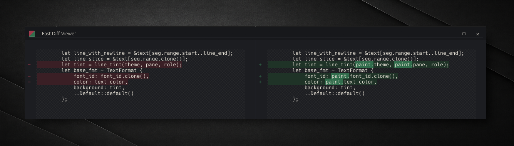

# Fast Diff Viewer



A desktop diff viewer for Windows, Ubuntu, and macOS built in Rust on
[eframe 0.37 / egui 0.37](https://github.com/emilk/egui).

## About

The more I use AI, the more I find myself wanting a tool to quickly
compare text and snippets when I'm not working inside an IDE or harness.
And existing diff viewers, especially on Windows, can be slow.

This project was created to provide a simple, fast diff viewer.

There are no features. Just the diff.

## Install

Download the matching asset from the
[latest release](https://github.com/binarysubstrate/fast-diff-viewer/releases/latest).

As a Windows archive (`fast-diff-viewer-windows-x64.zip`):

```shell
Expand-Archive .\fast-diff-viewer-windows-x64.zip
.\fast-diff-viewer-windows-x64\fast-diff-viewer.exe
```

As an Ubuntu archive (`fast-diff-viewer-ubuntu-22.04-x64.tar.gz` or
`fast-diff-viewer-ubuntu-24.04-x64.tar.gz`):

```shell
tar -xzf fast-diff-viewer-ubuntu-24.04-x64.tar.gz
./fast-diff-viewer
```

As a macOS 26 arm64 app bundle (`fast-diff-viewer-macos-26-arm64.tar.gz`):

```shell
tar -xzf fast-diff-viewer-macos-26-arm64.tar.gz
open "Fast Diff Viewer.app"
```

The macOS bundle is unsigned and not notarized. If the archive was downloaded
through a browser, macOS Gatekeeper will usually quarantine the app and may
block the `open` command with a warning that the developer cannot be verified.
After verifying the release checksum and deciding you trust this build, either
Control-click `Fast Diff Viewer.app` in Finder and choose Open, or remove the
quarantine attribute before launching:

```shell
xattr -dr com.apple.quarantine "Fast Diff Viewer.app"
open "Fast Diff Viewer.app"
```

Releases also include `SHA256SUMS.txt` for verifying downloaded binary
assets. Every binary package includes `LICENSE-MIT`, `LICENSE-APACHE`, and
`THIRD-PARTY-NOTICES.md` at the archive root.

From source with Cargo:

```shell
cargo install --path . --locked
```

## Documentation

- [`CONTRIBUTING.md`](CONTRIBUTING.md) contributions are welcome.
- [`docs/architecture.md`](docs/architecture.md) maps the runtime data flow
  and product constraints that shape it.
- [`docs/performance.md`](docs/performance.md) documents the fast-path
  algorithms, tradeoffs, and alternatives considered.
- [`docs/benchmark-contract.md`](docs/benchmark-contract.md) the
  active benchmark gates.
- [`bench/README.md`](bench/README.md) fixtures, runner behavior,
  benchmark history, and threshold rationale.
- [`docs/release.md`](docs/release.md) release workflows and package
  contents.
- [`scripts/README.md`](scripts/README.md) repository helper tools.

## License

Fast Diff Viewer is dual-licensed under either:

- Apache License, Version 2.0 ([LICENSE-APACHE](LICENSE-APACHE) or
  <http://www.apache.org/licenses/LICENSE-2.0>)
- MIT license ([LICENSE-MIT](LICENSE-MIT) or
  <http://opensource.org/licenses/MIT>)

at your option.

Unless you explicitly state otherwise, any contribution intentionally
submitted for inclusion in Fast Diff Viewer by you, as defined in the
Apache-2.0 license, is dual-licensed as above, without any additional terms or
conditions.
