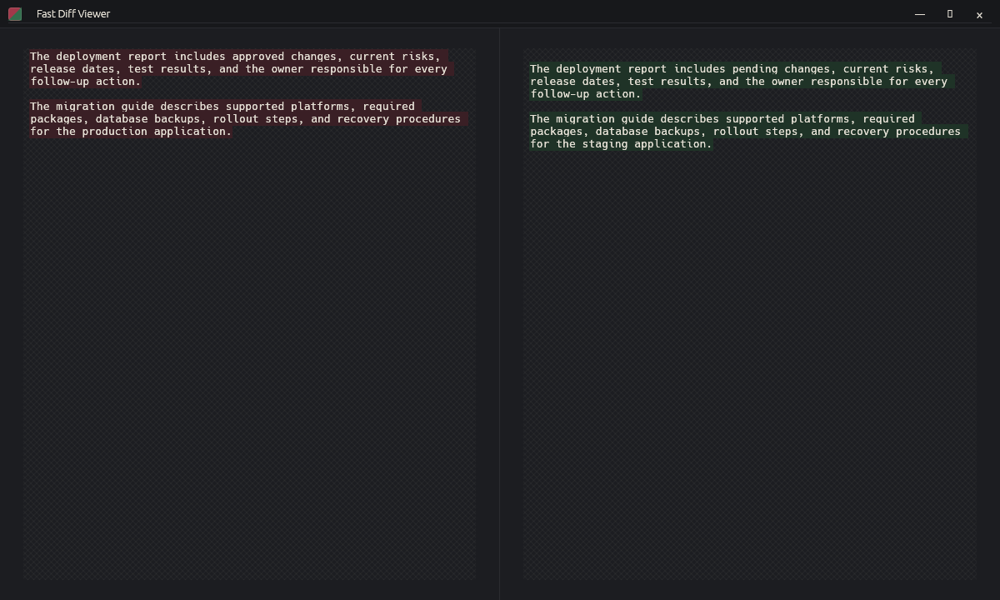
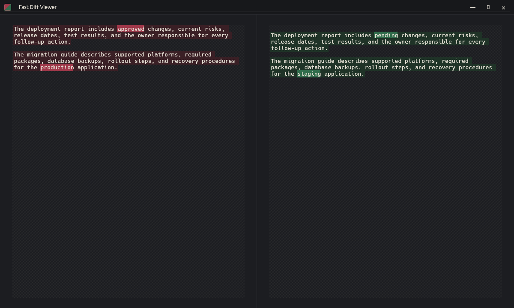
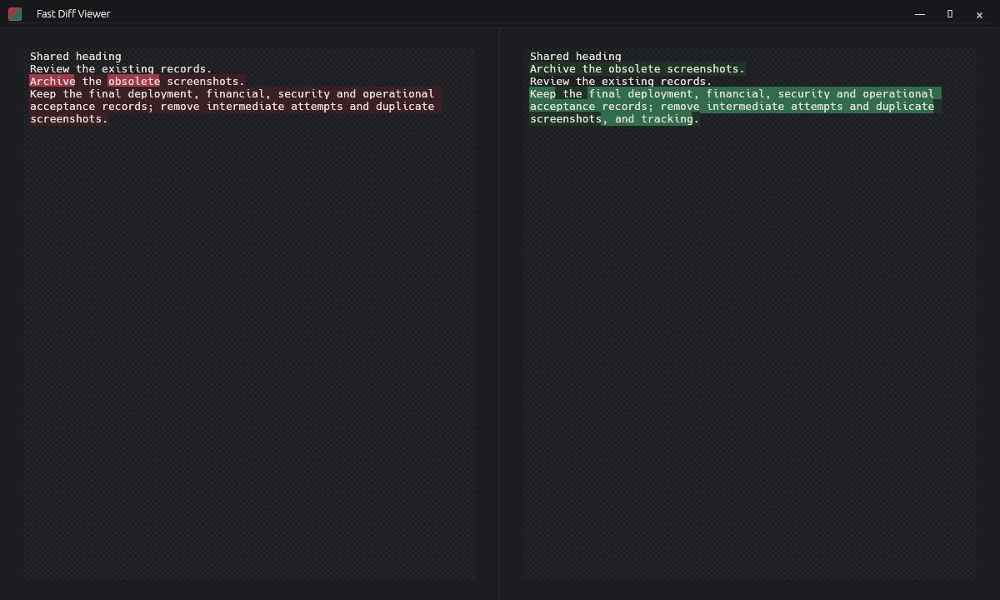
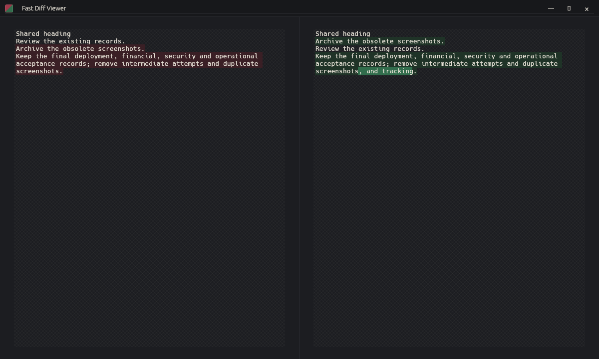
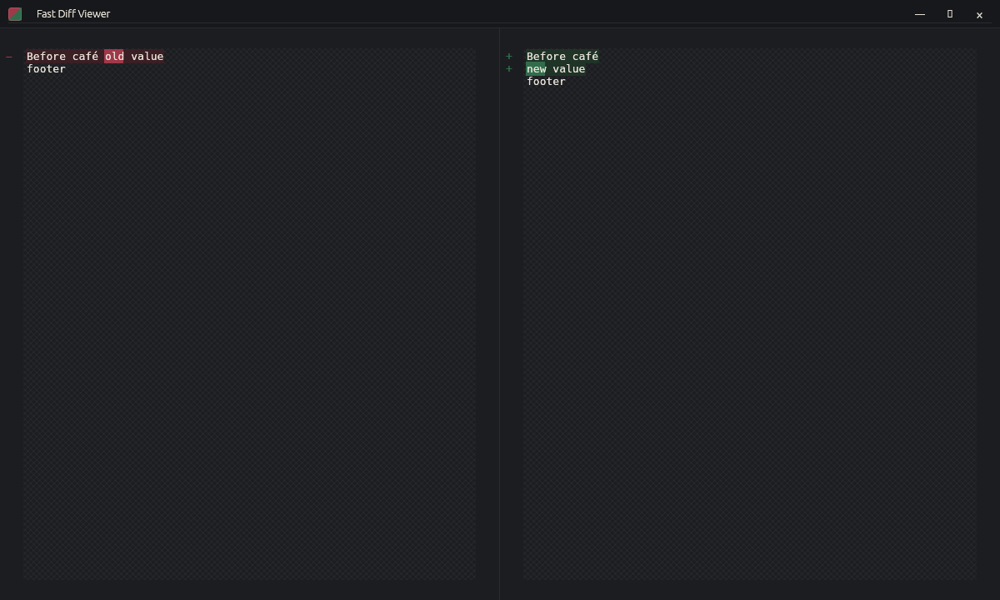
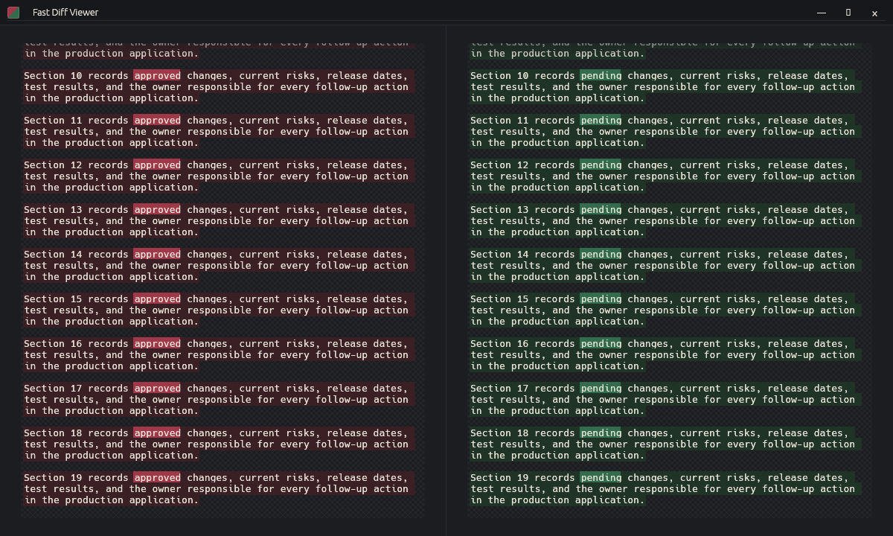

# v1.1.1 Highlight Review

Captured and reviewed on 2026-10-22 using the normal application at 1200 × 720 on Linux
under Xvfb with Mesa llvmpipe. The corrected source is
`c68ebd9296e9f687e04da82fc39627085b9fc325`; the baseline is v1.1.0.
The corrected executable's SHA-256 is
`a2c35614d91c20ef09753f11ed58457a9b5d28bbb244cfcd698da1b00cb1ea96`.

Inputs were pasted through the normal editors, then copied back to verify
the exact text. Clipboard round trips passed for all 29 cases: 19 diagnostic
and control cases plus the ten repeatable G1–G10 cases in
[`visual_contract_run_all.rs`](../../../scripts/visual_contract_run_all.rs).
The final capture set contains 37 screenshots, including top, middle, and
bottom views of the long split/join cases. The screenshots committed below
use only synthetic examples.

Design review disposition: **approved for this source and executable**. A
separate design reviewer inspected all 29 cases and 37 final screenshots,
including every top, middle, and bottom view of the long cases.

The original palette and four-pixel editor padding are preserved. Genuine
word edits remain distinct from line tint across blank lines, reordered rows,
splits, and joins. Unrelated text remains line-only; unchanged `café` receives
no false inline emphasis at a hard-wrap boundary. All 20 paragraph pairs stay
aligned through Section 19, with section numbers at line-tint strength and
only `approved` / `pending` receiving stronger word emphasis.

The existing default font's missing Japanese and emoji glyphs remain a
separate limitation; this capture set does not establish complete Unicode
glyph coverage. These Linux Xvfb screenshots do not satisfy the native
reference-workstation benchmark gate in
[`benchmark-contract.md`](../../benchmark-contract.md).

## Extra Blank Line (G1)

Before, both genuine word edits lose their stronger emphasis:

After, `approved` / `pending` and `production` / `staging` remain distinct
despite the extra leading blank line on the right:

## Reordered Rows (G3)

Before, the final paragraph is paired with the wrong row and receives broad,
misleading emphasis:

After, the moved row has line-level treatment and the final paragraph's
appended `and tracking` text receives localized word emphasis:

## Accented Split Boundary (G7)

Splitting after `café` leaves the unchanged accented word at line-tint strength;
only `old` / `new` receive stronger word emphasis. The footer stays neutral:

## Final Paragraph Correspondence (G9)

After the first paragraph is split, sections 10–19 still align with their
counterparts. Only `approved` / `pending` receive stronger word emphasis:

